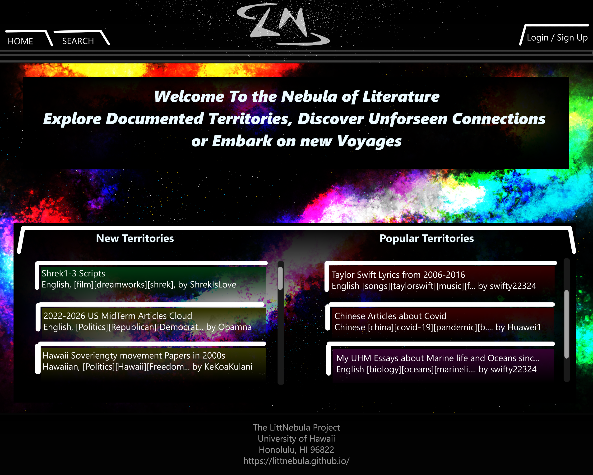
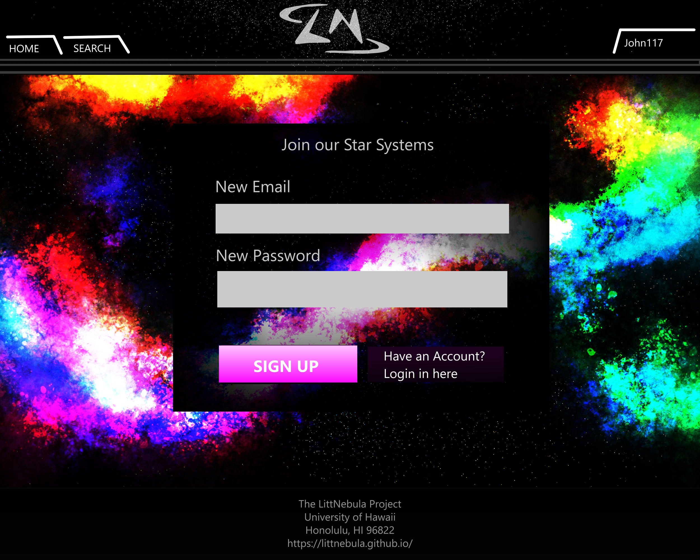
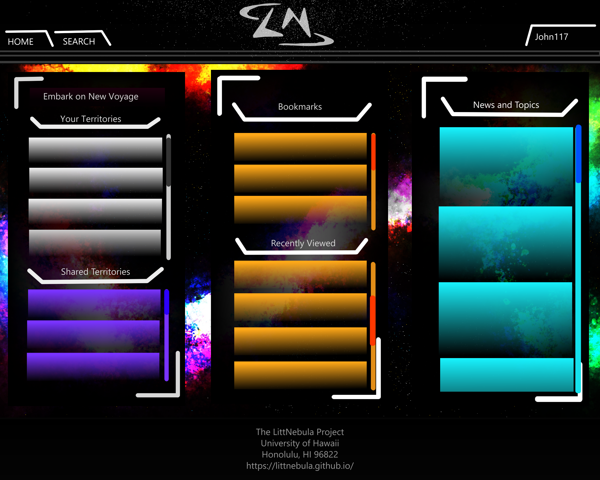
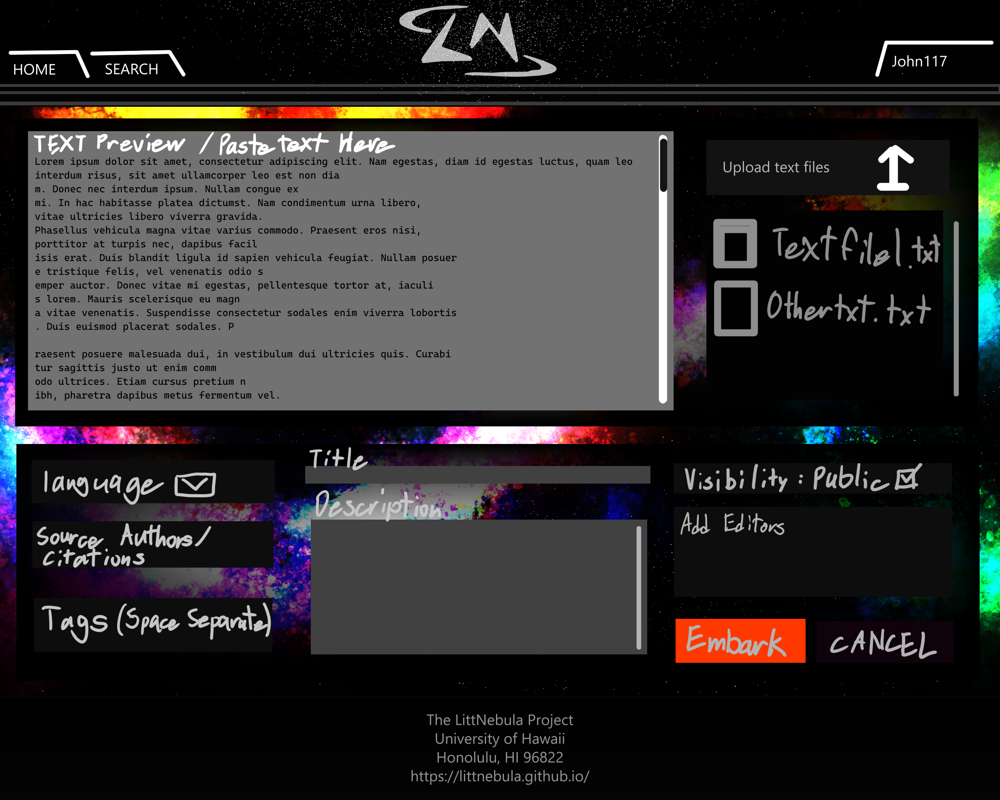
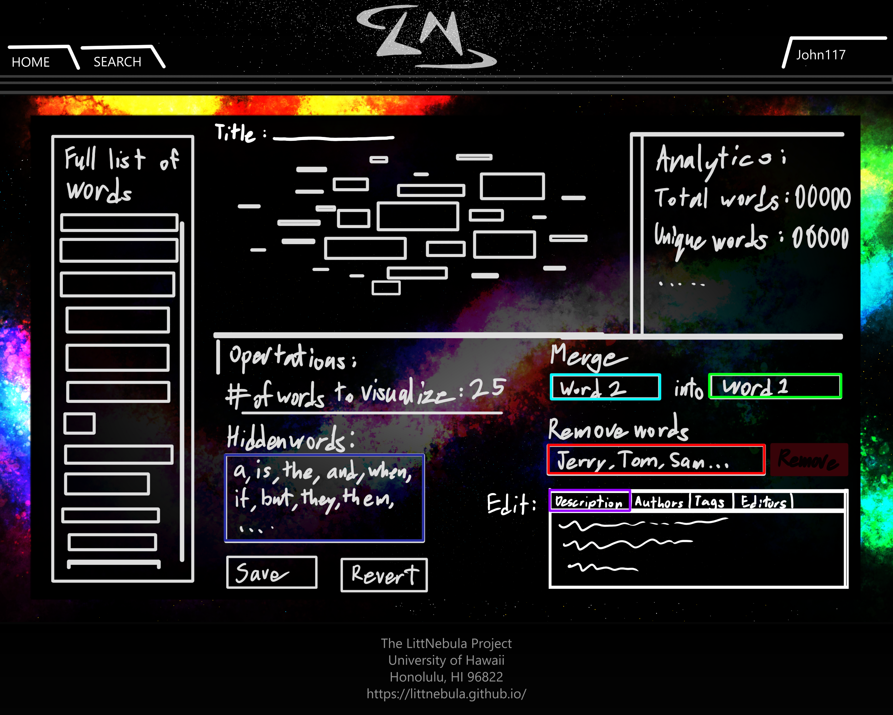
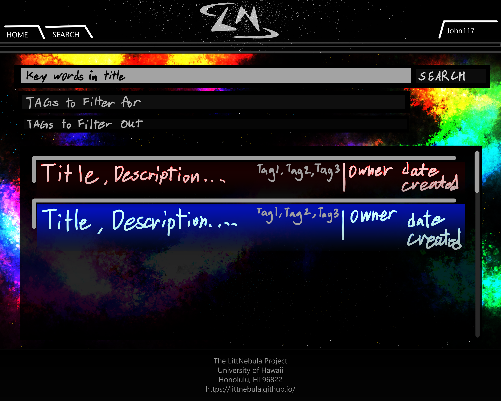

# LittNebula

## Table of contents
* [Overview](#overview)
* [User Guide](#user-guide)
* [Community Feedback](#community-feedback)
* [Developer Guide](#developer-guide)
* [Development History](#development-history)
* [Continuous Integration](#continuous-integration)
* [Example enhancements](#example-enhancements)
* [Team](#team)

## Overview
A hub where users can upload text, to be generated into word cloud data (word frequency dictionaries) that can be displayed as a visual cluster of words or an organized list, with tools for sharing, collaboration, research, and analysis. Word cloud data provides an analysis of both individual and collective thoughts from authors of a specific time period or culture, comparing the frequency of words and ideas used in different bodies of text and showing how they may change over time. LittNebula is a name inspired by the power of language and paying homage to ancient latin, one of the origins of the most widely spoken language in the world, where “Litt” is a shorthand for littera, meaning Literature and “Nebula”, meaning cloud. The modern concept of nebulas relating to space and astronomy invokes the same feeling of grandeur and depth that the research enabled by word clouds. Reinforcing this connection, the LittNebula utilizes a theme reminiscent of cosmology and astrological bodies in its color scheme, symbols, and terminology.

The is webpage utilizes software engineering frameworks and templates such as:
* [React](https://reactjs.org/) for component-based UI implementation and routing.
* [React Bootstrap](https://react-bootstrap.github.io/) CSS Framework for UI design.
* [Nextjs-Application-Template](https://ics-software-engineering.github.io/nextjs-application-template/) Application Template Starter

## User Guide

The front page for any new user will give a brief message on what they can do, with links to the landing, search, and login or registration page. Clicking on the center logo will direct you to the organization home page, this webpage, you are currently at.
### Landing Page

Immediately any visitor, login in or otherwise will be able to search, view and analyze cloud data, which will be referred  to as territories. To bookmark, perform comparative analysis, and create new territories, visitors must be logged in. 

### Registration

On the registration page, new users will be asked to supply their email address and a password for authentication.

### User Homepage

Upon successfully logging in users will be met with their curated home page which will display the territories they have created, have editing privileges to, have bookmarked for easy access and a list of their most recent territories interacted with. There will also be an announcements column that will display news shared by the site admins on special collaborations, events, links, or recommendations for territories to look at based on user interests.
New users will only be met with a mostly empty home page with a bright button prompting them to upload a text to start a new territory.

### Create New Territory

Plain text copies of the literary sources to be explored are allowed, Users can copy and paste text into a text area, or they can upload text files, which will be extracted and displayed in to the same input text area for users to review. Below the source text display, are options for the user to define such as the kind of language used in the source text, the the citations for each source text used, including links, tags for more better search results, a title and description of the word cloud data, sharing edit access to other users by defining their emails, and the visibility of the territory to other users on the webpage.

### Edit Territory

After creating the word cloud data, users are directed to the edit page of that word cloud data, where they can immediately see every unique word that was found, the number of times each one shows up, the resulting visual representation of that word cloud based on default settings, and options for excluding words, merging word frequencies for similar words, and modifying other aspects of the territory.

### Searching

For searching for the specific territories, users can input key words in titles, or for specific topics, filtering all public territories by their tags. For private territories, users can only access those via their bookmarks or by accessing the direct links shared by the owners of those territories.

## Community Feedback

We are interested in your experience using LittNebula! If you would like, please take a couple of minutes to email us at LitteraNebulaTeam@gmail.com, telling us about any issues, suggestion for improvements or other comments on your use of the site and how we can improve the site to enhance that experience.

### Application Design

LittNebula is based upon [Nextjs-Application-Template](https://ics-software-engineering.github.io/nextjs-application-template/). Please use the videos and documentation at this site to better acquaint yourself with the basic application design in LittNebula.

### Data model

LittNebula utilizes 3 distinct primary collections (Users, Wordclouds, and Comments)

Users mush a unique email and a corresponding password for authentication. 
Each user will have collections of unique wordcloud ids to denote which wordclouds they own, have editing priviliges to, or have bookmarked for review.

New users can create Wordclouds
Each Wordcloud will contain a dictionary of unqie words and the the amount of times they appear in the given source text, the total number of words in those source text, the language used, citations for each text used to generate the word cloud, a title and description describing what the wordcloud is about, tags for more detailed search results, and a collection of comments by users. 

All wordclouds and comments will have a unique Id and an owner property that will be used to show who created them and who has access to modify or delete them.

## Development History
* 2026-11-05 : Create development document for initial planning of project execution. 
* 2026-11-06 : Create organization Homepage and web application repository. 

## Continuous Integration
LittNebula is developed in accordance with coding standards outlined with ESlint and at every commit, unit testing is performed and documented through github actions.

## Example Enhancements

There are a number of simple enhancements you can make to the system to become better acquainted with the codebase:
* Allow users to upload their own profile picture
* Assigning a thumbnail to each Territory
* Expand the comparison feature to allow for more than 2 territories.
* For each word in the Word cloud visualization, make the word into a link that opens a dictionary definition page or a custom link defined by the owner
* Expand the text file text extractor to allow for other text documents like docx, pdf, or code file like jsx or tsx.
* Create a more robust search engine that can still give results for key words, or tags that are slightly misspelled. 
* Allow for key words entered in the search bar to be examined in descriptions, citations, and editors list. Or search explicitly for word clouds owned by a specific user.
* Update word extraction algorithm to work with more languages

## Team

LittNebula is designed, implemented, and maintained by [Kevin Lee](https://leek7.github.io/) and [Au Quang](https://quangau0298.github.io/).
